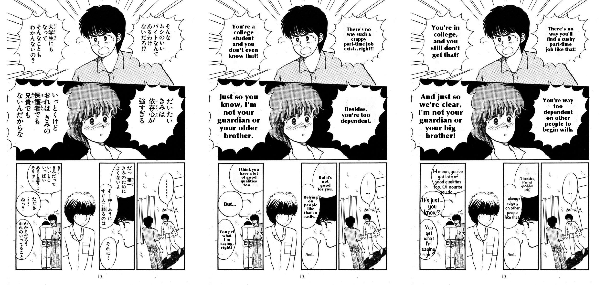
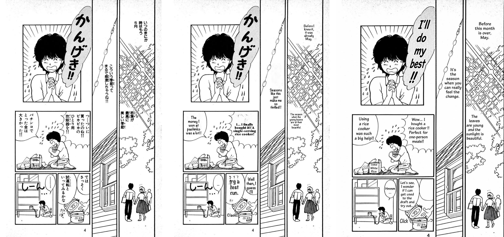
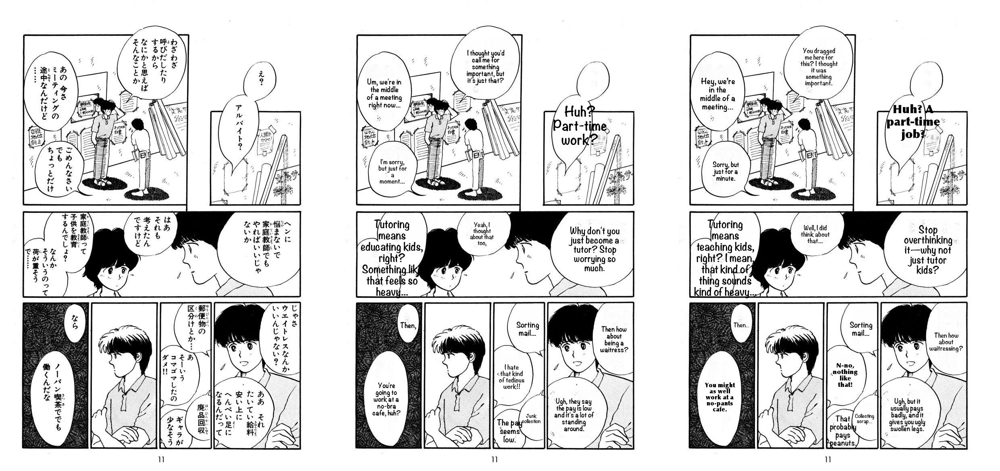
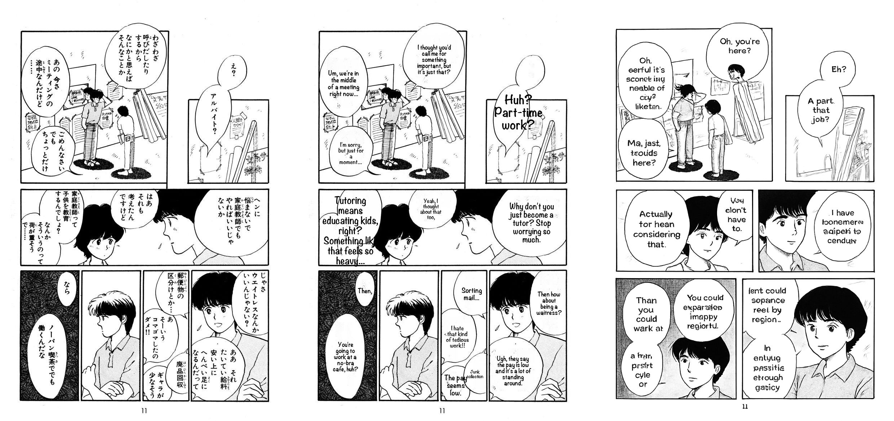
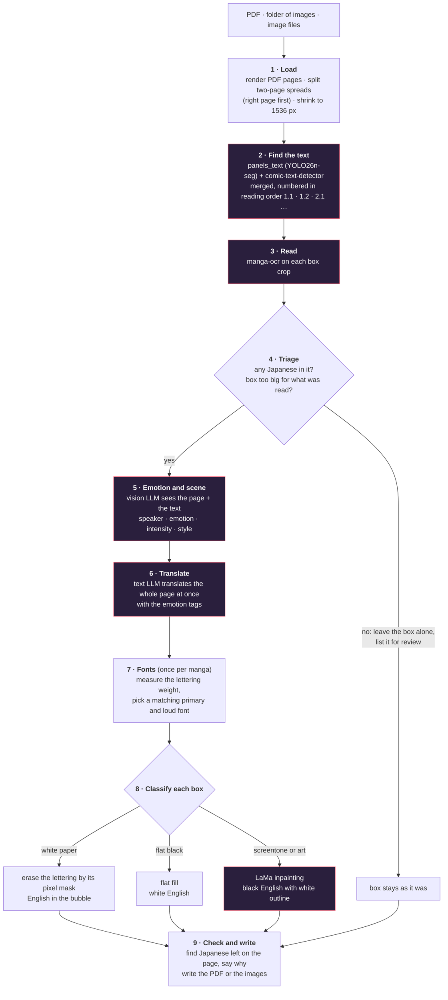

<p align="center">
  
</p>

<p align="center">
  <b>Give it a PDF or a folder of page images. Get the translated pages back.</b><br>
  No cloud, no API keys, no manual steps.<br>
  <sub>OpenAI models appear only in the <a href="#cloud-vs-local">comparison experiments</a>.</sub>
</p>

```bash
mangakaro translate manga/input/my-volume          # a folder of images  →  manga/output/my-volume/pages/
mangakaro translate manga/input/book.pdf           # a PDF               →  manga/output/book/book.translated.pdf
mangakaro translate pages/*.png -o translated/     # a list of files     →  translated/
```

> **Status: a working prototype, not a finished product.** Speech bubbles on white paper work well. Text over art works
> less well, and sound effects, background signs and large display lettering are left in Japanese. Translation quality has
> **not** been scored against reference translations: everything below was judged by eye, by someone who does not read
> Japanese (and, for the cloud comparison, by a language model: see [how much to trust it](#how-much-to-trust-this)). See [What still goes wrong](#what-still-goes-wrong).

## Contents

| | |
| --- | --- |
| [At a glance](#at-a-glance) | the short answers |
| [Before and after](#before-and-after) | five real pages, including one that goes wrong |
| [Experiments](#experiments) | what we measured and why the design is what it is |
| &nbsp;&nbsp;↳ [Cloud vs local](#cloud-vs-local) | `gpt-6.1-sol`, `gpt-5.4-mini` and two image models against the local pipeline ([arms](#the-arms) · [results](#how-each-one-did-against-local) · [what to take](#what-to-take-from-it) · [trust](#how-much-to-trust-this) · [reproduce](#reproduce-it)) |
| &nbsp;&nbsp;↳ [Earlier design experiments](#earlier-design-experiments) | readers, translators, detectors, erasers |
| &nbsp;&nbsp;↳ [Local runs](#local-runs) | counts and times on whole chapters |
| [How it works](#how-it-works) | the pipeline and the models in it |
| [Install](#install) · [Use it](#use-it) | set up and run |
| [What still goes wrong](#what-still-goes-wrong) | the known failures |
| [Project layout](#project-layout) · [Licenses](#licenses) | |

<sub>[↑ Contents](#contents)</sub>

## At a glance

| Question | Short answer | Where |
| --- | --- | --- |
| Does it work? | On speech bubbles, yes. Local, about **41 s a page** and $0 on an Apple-silicon Mac. Sound effects and big display lettering stay in Japanese. | [Before and after](#before-and-after) |
| Would a cloud LLM do better? | A little. `gpt-6.1-sol` made at most one clear translation error where local made six, at **$0.021 a page**. `gpt-5.4-mini` is slightly better than local at **$0.006 a page and about 15 s**. | [Cloud vs local](#cloud-vs-local) |
| Can one image model do the whole job? | No. `gpt-image-2` invented lines on all four pages and `gpt-image-1-mini` garbled the lettering. | [Image models](#how-each-one-did-against-local) |
| What does it get wrong? | Reading order, text over art, narrow bubbles, OCR misreads. | [What still goes wrong](#what-still-goes-wrong) |
| How do I run it? | A few setup commands, then one command. | [Install](#install) · [Use it](#use-it) |

<sub>[↑ Contents](#contents)</sub>

## Before and after

All pages below are from the [Manga109](http://www.manga109.org/) dataset (*Aisazu Niha Irarenai*), translated in one run with the
default models. Left: the original. Right: the output. Nothing was touched by hand.

**A good page.** Seven speech bubbles on white paper and over a dark panel, each erased and re-lettered in English.


**A mixed page.** Bubbles are fine; the sound effects around the pot are left in Japanese on purpose, and one vertical caption was never detected (top right).


**Text over screentone and drawing.** The lettering that sits on tone is erased with LaMa and the English gets a white outline.
One bubble in the lower middle is too narrow, so its English is small.


**A page that goes wrong.** The big "かんげき!!" lettering at the top is display lettering and is left in Japanese. In the bottom-right panel one sentence is
split across two bubbles, and because English reads left to right it comes out backwards ("try a test run." sits left of "Well then, I guess I'll").
The long line "I… finally bought it!!" also sits outside any bubble. Reading order and matching text to bubbles is the weak spot.


**A page it must not touch.** This is a block of prose. Before the safety check (middle) the pipeline erased it and wrote an invented
sentence in its place, because the OCR can only read one line or bubble at a time. Now (right) such a box is left alone and
listed for review.


<sub>[↑ Contents](#contents)</sub>

## Experiments

Everything here was run on real pages; the full record, with the mistakes, is in [docs/PROGRESS.md](docs/PROGRESS.md). Start with the cloud comparison: it is the one that answers
"is a cloud LLM better than what runs on this Mac?".

### Cloud vs local

**Question:** would a paid cloud model do this job better, cheaper or faster than the local one?

The same four Manga109 pages (`006_L`, `005_L`, `009_L`, `002_R`) went through the local pipeline and through OpenAI models. Each cloud result was judged
against the local result, page by page, by Claude Sonnet 5.5 against a five-point rubric (fidelity, no invented text, naturalness, art kept, lettering fit).
The full per-page evidence is in [docs/JUDGE_REVIEW.md](docs/JUDGE_REVIEW.md) and the verdicts are in [docs/judge_verdicts.json](docs/judge_verdicts.json).

Every pipeline arm is the same program. Only the model behind some steps changes: a model named `openai:<id>` is sent to the OpenAI API instead of Ollama
([`mangakaro/openai_backend.py`](mangakaro/openai_backend.py)). So `gpt-6.1-sol` here is the same prompts and the same pipeline with a stronger vision-capable LLM call;
detection, erasing and typesetting are identical. The image-model arms skip the pipeline entirely.

| Step | Local | `gpt-…` + our OCR | `gpt-…` reads too | Image model |
| --- | --- | --- | --- | --- |
| Find the text, order it | ours | ours | ours | – |
| Read the Japanese | manga-ocr | manga-ocr | **the LLM** | – |
| Emotion, scene, translation | Gemma 4 | **the LLM** | **the LLM** | – |
| Erase and typeset | ours | ours | ours | **the image model does all of it in one call** |

#### The arms

| Arm | What does the work | $ per page | Seconds per page |
| --- | --- | --- | --- |
| **Local** | our detectors, manga-ocr, **Gemma 4** through Ollama, our renderer | 0 | **41** (165 s for the 4 pages, measured 2026-10-20) |
| `gpt-6.1-sol` + our OCR | same pipeline, `gpt-6.1-sol` for emotion and translation | 0.021 | about 44* (40 measured, plus about 4 for detection and OCR) |
| `gpt-6.1-sol` reads too | like the above, but `gpt-6.1-sol` also reads the Japanese | 0.034 | about 53* (52 measured, plus about 1 for detection) |
| `gpt-5.4-mini` + our OCR | same pipeline, `gpt-5.4-mini` for emotion and translation | **0.006** | 15 (61 s for the 4, of which 47 s was loading models; the other pages took 3 to 6 s) |
| `gpt-5.4-mini` reads too | like the above, but the model also reads | 0.009 | 14 (57 s for the 4) |
| `gpt-image-2` | one image model: page in, translated page out, no pipeline | 0.049 | 34 |
| `gpt-image-1-mini` | the cheaper image model | 0.015 | 18 |

\*Estimate. The sol arms reused box detection (and, with our OCR, the reading) from an earlier run, so their measured 40 and 52 s leave those out. Detection (about 5 s) and manga-ocr (13.6 s) for the 4 pages were added from
the local run, because that compute is the same in every arm. Of the measured time, about 35 s a page is the `gpt-6.1-sol` calls themselves (it is a slow model, about 18 s a call). The mini and local times are full runs from scratch.
The image models have no pipeline, so their time is the whole job.

#### How each one did against local

Page verdicts, over four pages: **cloud wins / tie / local wins**.

| Cloud arm | Verdicts | In one line |
| --- | --- | --- |
| `gpt-6.1-sol` + our OCR | 2 / 2 / 0 | Better translation, same rendering. Local has errors it does not. |
| `gpt-6.1-sol` reads too | 2 / 2 / 0 | The same, and it fixed three OCR misreads. Costs 60% more. |
| `gpt-5.4-mini` + our OCR | 1 / 3 / 0 | A little better than local, at under a third of the price of sol. |
| `gpt-5.4-mini` reads too | 1 / 1 / 2 | Dropped two bubbles on one page and misread two lines on another. |
| `gpt-image-2` | 0 / 0 / 4 | Invents most lines, redraws bubbles and faces. |
| `gpt-image-1-mini` | 0 / 0 / 4 | Garbled lettering, a different drawing of each page. |



*Original, local, `gpt-6.1-sol`. Same artwork, both accurate; the cloud English is a little more idiomatic.*

- **Local has six clear translation errors on these four pages**: "crappy" for ムシのいい, "no-bra" for ノーパン, "a lot of standing around" for flat feet,
  the sukiyaki line reversed, "Neshima-san" for 成島 (the page's furigana says なるしま), and "Yaga" for 平井 (that one is the OCR's misreading).
  `gpt-6.1-sol` with our OCR has only the last, and `gpt-6.1-sol` reading for itself has none.
- **The OCR's misreads are shared by every arm that uses it.** manga-ocr read 平井 as やが and 荷が重そう as 何が重そう, and the English written from them inherited it.
  That is where letting the cloud model read helped; it is also where it failed (mini dropped bubbles that manga-ocr never skipped).
- **The image models are not a shortcut.** `gpt-image-2` writes "so there's no way a weightlifting gym would be a good option?" on a page where nobody says that, and
  "Cooked White Rice" on a box that has no text. `gpt-image-1-mini` is unreadable.



*Original, local, `gpt-image-2`: the bubbles and faces are redrawn, the big lettering is translated wrongly ("I'll do my best!!"), and a box gets text that was never there.*



*Original, local, `gpt-5.4-mini` with our OCR: natural English, the artwork untouched.*



*Original, local, `gpt-image-1-mini`.*

#### What to take from it

| If you want | Use | Why |
| --- | --- | --- |
| The best price for good output | `gpt-5.4-mini` + our OCR | $0.006 a page. A 20-page chapter is about 2 minutes and 12 cents. |
| The most accurate English | `gpt-6.1-sol` (our OCR is nearly as good as letting it read) | No clear errors found. About 43 cents a chapter with our OCR. |
| Free and offline | local | About 41 s a page. About as good on layout; more translation errors. Roughly 14 minutes for a 20-page chapter. |
| Nothing else | not the image models, not mini reading for itself | Invented lines, garbled text, silently dropped bubbles. |

Counting the whole path, local (about 41 s a page) is about as fast as `gpt-6.1-sol` (about 44 to 53 s, a slow model) and 2 to 3 times slower than `gpt-5.4-mini`.

#### How much to trust this

- **One judge, four pages, no reference translation.** The judge is a language model reading Japanese, not a native reader.
- **The review was not blind**: the judge saw the per-line tables (which show local's English) before the sheets, and a second blind pass was not possible in the same session.
  Instead the claims that decide the verdicts were checked against the original page at 3 to 4x (the 平井, 成島 and 荷が重そう readings above). A first draft of the review had
  one of them wrong, and it was fixed. See the end of [docs/JUDGE_REVIEW.md](docs/JUDGE_REVIEW.md).
- Fit scores are close for every pipeline arm because they share one renderer.
- Prices and model names were copied from OpenAI's pricing page on 2026-10-19 by a tool: check them.
- Whether this holds for a whole volume, other genres, or a native reader is untested.

#### Reproduce it

```bash
uv pip install --python .venv/bin/python -e ".[compare]"                 # adds the openai package
export OPENAI_API_KEY="..."                                               # read from the environment, never written to disk
.venv/bin/python -m experiments.openai_compare --dry-run                  # checks the key and models; makes no paid call
.venv/bin/python -m experiments.openai_compare --max-usd 1.5              # runs the arms, with a hard spending cap
.venv/bin/python -m experiments.openai_compare --arms D --out compare-local-timing --no-import   # the local arm alone, free
.venv/bin/python -m experiments.judge_pack                                # blind pair sheets and per-line tables for judging
```

### Earlier design experiments

Each choice was made from a test on real pages. The full record, with the mistakes, is in [docs/PROGRESS.md](docs/PROGRESS.md).

| Question | What we found | Decision |
| --- | --- | --- |
| Can a 4B vision model read Japanese off the page? | No. It invented text and mixed romaji into Japanese. | Read with manga-ocr, which can only output what is in the crop |
| Does splitting read / emotion / translate into stages help the small model? | Not by itself (slower than one call, no better at reading), but each stage can use a different model and be redone alone | Keep the stages |
| Which model translates best? | Compared `qwen3.5:4b`, `qwen3:8b` and `gemma4:e4b-mlx` by eye: Gemma gave the most natural English | Gemma for emotion and translation |
| Can the model skip lines? | Yes: it returned 1 of 11 lines on one page | Ask again for the missing lines, then line by line |
| Can the model stall? | Yes: calls looped on garbled text | 180 s limit, length cap, chunks of 4 lines |
| One detector or two? | `panels_text` misses thought bubbles and margin text | Merge in a second detector's extra boxes |
| Erase by darkness or by mask? | Darkness also removed bubble outlines and black backgrounds | Erase by the lettering's pixel mask |
| OpenCV inpainting or LaMa? | OpenCV leaves cloudy patches over screentone; LaMa continues the texture but can leave a smudge on hair; a flat fill beats LaMa on solid black | LaMa for overlays, flat fill for black |
| Can the OCR be trusted on big boxes? | No: on a block of prose it returned a short invented sentence | Triage before erasing |

### Local runs

Measured on the development Mac with the default models. None of this is translation *quality*, which has not been scored against reference translations.

| Run | Pages | Text blocks | Typeset | Overflow | Skipped | Time |
| --- | --- | --- | --- | --- | --- | --- |
| 20-page chapter (mangahaha) | 20 | 187 | 176 | 10 | 1 | about 10 to 20 min |
| Manga109 sample (11 spreads → 22 pages), before triage | 22 | 184 | 172 | 8 | 4 | 1,777 s (about 80 s per page; the two covers took 336 s of model time) |
| The 4 pages of the cloud comparison, from scratch, 2026-10-20 | 4 | 51 boxes | 47 | 3 | 0 | 165 s (about 41 s per page); left-over check off, Gemma pre-warmed |

On the Manga109 sample the check found 15 pieces of Japanese still on the pages: 10 never detected, 3 skipped on purpose, 2 badly erased.
The triage step was added after this run and has only been replayed on its cached readings, not re-run in full.

<sub>[↑ Contents](#contents)</sub>

## How it works



Boxes in purple use a model. Every stage is cached in the work directory, so an interrupted run resumes where it stopped and one stage can be redone
(`--redo translate`). Pages are finished one at a time, so you can open the first translated page while the rest are still running.

### Models, by step

| Step | Model | Runs on | License (from the model's page; check before redistributing) |
| --- | --- | --- | --- |
| Text boxes and panels | [`comic-panels-text-detect`](https://huggingface.co/Oliverdsfdsf/comic-panels-text-detect) (YOLO26n-seg) | CPU | Apache-2.0 |
| Extra text boxes and the lettering pixel mask | `comic-text-detector` (ONNX, from [manga-image-translator](https://github.com/zyddnys/manga-image-translator)) | CPU | GPL-3.0 |
| Speech bubble shapes | [`manga_bubbles_detect`](https://huggingface.co/PSImera/manga_bubbles_detect) (YOLOv8) | CPU | MIT |
| Reading Japanese | [`kha-white/manga-ocr-base`](https://huggingface.co/kha-white/manga-ocr-base) | Apple GPU (MPS) or CPU | Apache-2.0 |
| Emotion and scene | `gemma4:e4b-mlx` through [Ollama](https://ollama.com) | local | see Ollama |
| Translation | `gemma4:e4b-mlx` through Ollama (any Ollama model works) | local | see Ollama |
| Erasing over art | [`big-lama`](https://github.com/advimman/lama) (LaMa, TorchScript) | CPU | Apache-2.0 per the LaMa repository |
| Fonts | system fonts, picked by stroke weight (no model) | – | each font's own license |

The YOLO weights are run with Ultralytics (AGPL-3.0). Models that were tried and not kept are in [Earlier design experiments](#earlier-design-experiments).

<sub>[↑ Contents](#contents)</sub>

## Install

You need a Mac with Apple silicon (what it was built on; other machines are untested), Python 3.11+, [uv](https://docs.astral.sh/uv/) and
[Ollama](https://ollama.com) running locally. The default model is about 9.5 GB.

```bash
uv venv .venv
uv pip install --python .venv/bin/python -e .
ollama pull gemma4:e4b-mlx
```

The first run downloads the OCR model from Hugging Face. Put these weight files in `weights/` (or set `MANGAKARO_WEIGHTS`):

| File | Source |
| --- | --- |
| `comic-panels-and-text-detect.safetensors` | https://huggingface.co/Oliverdsfdsf/comic-panels-text-detect |
| `bubbles_detect.pt` (a pickle: load only from this source) | https://huggingface.co/PSImera/manga_bubbles_detect |
| `comictextdetector.pt.onnx` | the `comic-text-detector` release linked from https://github.com/zyddnys/manga-image-translator/releases |
| `big-lama.pt` (optional, about 196 MB) | https://github.com/enesmsahin/simple-lama-inpainting/releases/download/v0.1.0/big-lama.pt |

Without `big-lama.pt`, text over art is erased with OpenCV's basic inpainting. Load LaMa this way; do not `pip install simple-lama-inpainting`,
which pins old numpy, opencv and pillow and downgrades them. Then check everything:

```bash
.venv/bin/mangakaro check
```

<sub>[↑ Contents](#contents)</sub>

## Use it

Put manga under `manga/input/`. Output goes to `manga/output/<name>/`, with `work/` beside it. The whole `manga/` folder is git-ignored.

```
manga/
├── input/
│   ├── my-volume/            page images (natural order: page2 before page10)
│   └── book.pdf
└── output/
    └── my-volume/
        ├── pages/            translated pages, one image per page (_R and _L for split spreads)
        └── work/             pages, cached model results, rendered/, reports/, checks/, fonts.json, summary.json
```

| Option | What it does |
| --- | --- |
| `-o, --output` | a path ending in `.pdf` writes one PDF; any other path is a folder of images |
| `--work-dir` | where cached results go (default: beside the output). Re-running resumes from it |
| `--pages 1-5,8` | only these pages (1-based position in the sorted input) |
| `--emotion-model`, `--translate-model` | any Ollama models; the emotion model must see images |
| `--reader ocr\|vlm` | read text with manga-ocr (default) or a vision model |
| `--max-side 1536` | longest side in pixels of the pages the models see and the output has |
| `--plain-only` | translate only plain white bubbles; leave text on dark areas and over art alone |
| `--no-lama` | use OpenCV instead of LaMa (faster, smears more) |
| `--no-check` | skip the check for Japanese left on each finished page |
| `--no-split-spreads` | keep two-page spreads as one page |
| `--fonts picks.json` | fixed fonts instead of automatic choice |
| `--redo translate` | ignore the cache from this stage onward (`read`, `emotion`, `translate`) |

Output pages are raster images, so text in an output PDF is not selectable.

<sub>[↑ Contents](#contents)</sub>

## What still goes wrong

- **Display lettering, titles and sound effects stay in Japanese.** The emotion model's "sound effect" label is also unreliable: 4 of 5 labels on one page were shouted dialogue.
- **Reading order and bubble matching** can put a sentence in the wrong bubble (see the failing page above).
- **OCR mistakes reach the translation.** Short vertical strings are sometimes misread (a speaker name 平井 came out as やが, and 荷が重そう as 何が重そう), and the translator turns garbled text into a confident wrong sentence.
- **Narrow bubbles get small text,** and in about 30% of typeset blocks the safe area in the bubble was too small and the detector's box was used, so English can touch or cross the outline.
- **Small side notes and some vertical captions are never detected** by either detector.
- **Text over art leaves marks** on hair and faces, and a few narrow columns stay at about 10 px.
- **Not scored.** There are no reference translations; the quality notes come from looking at the output.
- Japanese to English only. Fonts are matched on weight, not letter shape.

<sub>[↑ Contents](#contents)</sub>

## Project layout

```
mangakaro/        the package: cli, pipeline, pages, detect, ocr, stages, prompts, llm, fonts, render, inpaint, verify, pdfio, paths
                  (openai_backend.py is only used by the cloud comparison; the translator itself needs no cloud)
experiments/      scripts used to decide the design (detector comparison, one-shot translation, review sheets, the cloud comparison and its judging sheets)
tests/            unit tests for everything that needs no models
docs/             ARCHITECTURE.md (design and thresholds), PROGRESS.md (the full record), JUDGE_REVIEW.md (cloud vs local, judged), images/
data/, output/    cached results and review sheets from the experiments
manga/            your inputs, outputs and work directories (git-ignored)
weights/          model weights (git-ignored)
```

```bash
.venv/bin/python -m unittest discover tests -v
```

The tests need no models. More: [docs/ARCHITECTURE.md](docs/ARCHITECTURE.md) has every module, data format and threshold;
[docs/PROGRESS.md](docs/PROGRESS.md) has the experiments, the mistakes and the lessons; [docs/JUDGE_REVIEW.md](docs/JUDGE_REVIEW.md) has the cloud comparison page by page.

<sub>[↑ Contents](#contents)</sub>

## Licenses

This project's own code has no license file yet. It depends on models and libraries with different licenses (listed above); the lettering-mask
detector is GPL-3.0 and Ultralytics is AGPL-3.0, so check them before distributing anything built on them. The sample pages are from Manga109,
which has its own terms of use: check them before redistributing the images in `docs/images/`.

<sub>[↑ Contents](#contents)</sub>
