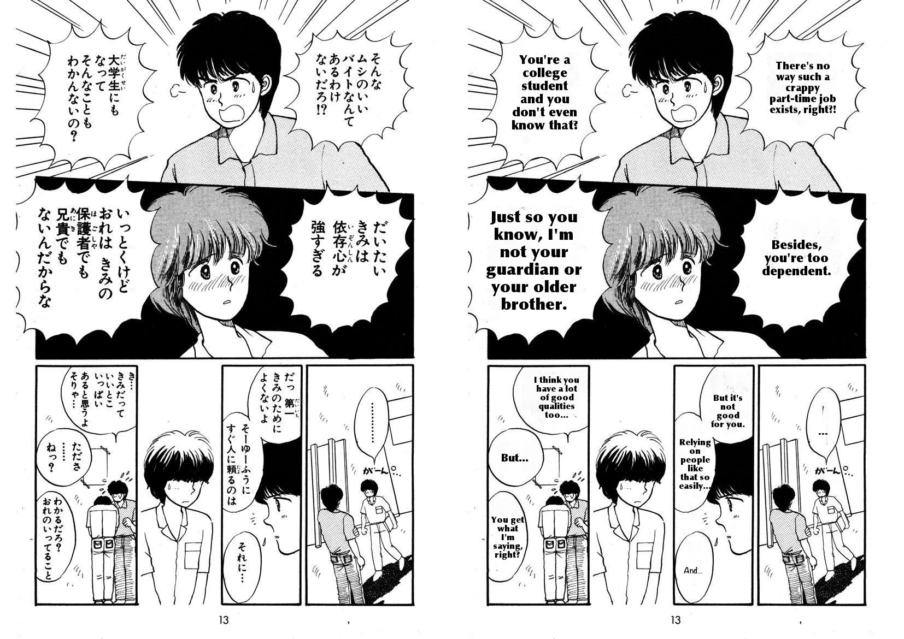
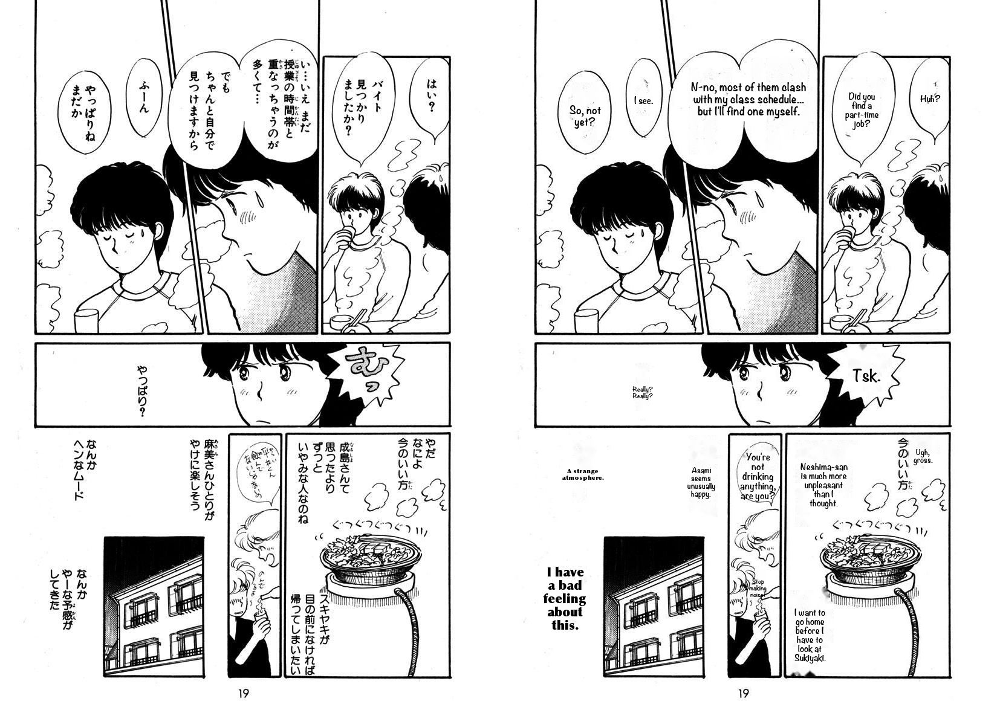
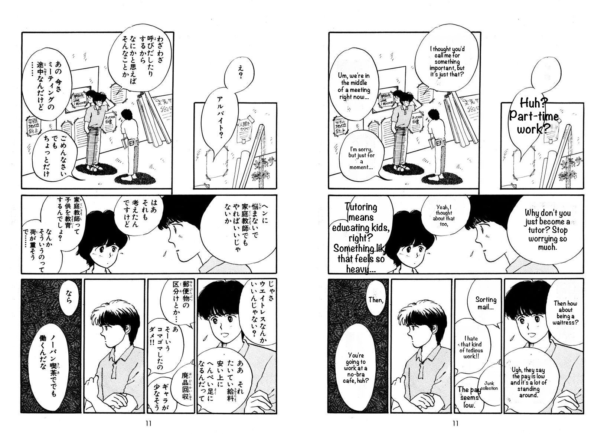
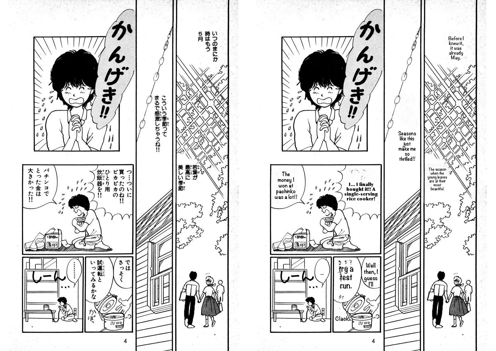
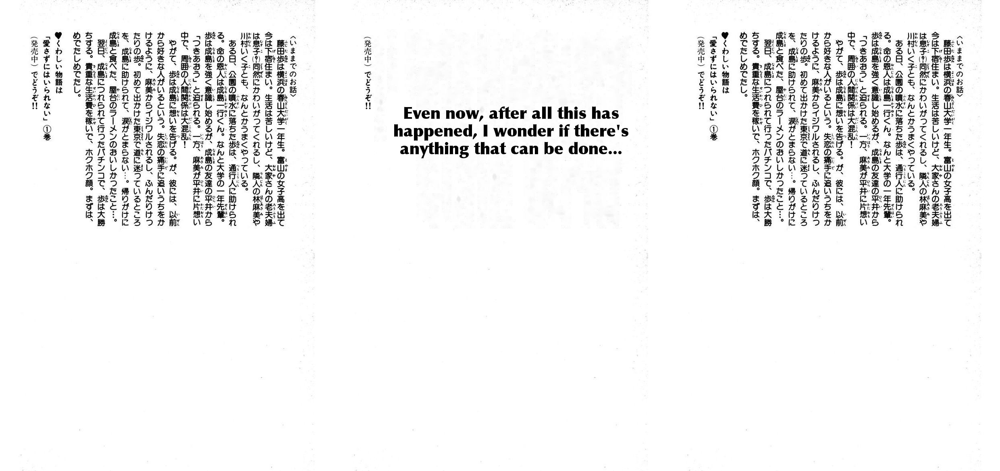
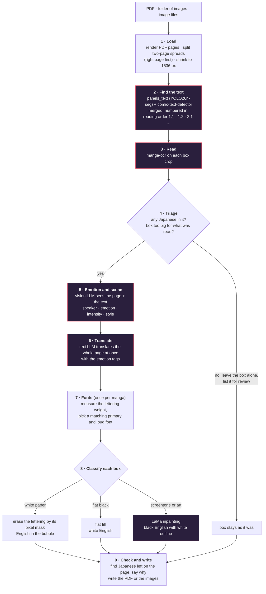

<p align="center">
  
</p>

<p align="center">
  <b>Give it a PDF or a folder of page images. Get the translated pages back.</b><br>
  No cloud, no API keys, no manual steps.
</p>

```bash
mangakaro translate manga/input/my-volume          # a folder of images  →  manga/output/my-volume/pages/
mangakaro translate manga/input/book.pdf           # a PDF               →  manga/output/book/book.translated.pdf
mangakaro translate pages/*.png -o translated/     # a list of files     →  translated/
```

> **Status: a working prototype, not a finished product.** Speech bubbles on white paper work well. Text over art works
> less well, and sound effects, background signs and large display lettering are left in Japanese. Translation quality has
> **not** been scored against reference translations: everything below was judged by eye, by someone who does not read
> Japanese. See [What still goes wrong](#what-still-goes-wrong).

## Before and after

All pages below are from the [Manga109](http://www.manga109.org/) dataset (*Aisazu Niha Irarenai*), translated in one run with the
default models. Left: the original. Right: the output. Nothing was touched by hand.

**A good page.** Seven speech bubbles on white paper and over a dark panel, each erased and re-lettered in English.



**A mixed page.** Bubbles are fine; the sound effects around the pot are left in Japanese on purpose, and one vertical caption was never detected (top right).



**Text over screentone and drawing.** The lettering that sits on tone is erased with LaMa and the English gets a white outline.
One bubble in the lower middle is too narrow, so its English is small.



**A page that goes wrong.** The big "かんげき!!" lettering at the top is display lettering and is left in Japanese. In the bottom-right panel one sentence is
split across two bubbles, and because English reads left to right it comes out backwards ("try a test run." sits left of "Well then, I guess I'll").
The long line "I… finally bought it!!" also sits outside any bubble. Reading order and matching text to bubbles is the weak spot.



**A page it must not touch.** This is a block of prose. Before the safety check (middle) the pipeline erased it and wrote an invented
sentence in its place, because the OCR can only read one line or bubble at a time. Now (right) such a box is left alone and
listed for review.



## How it works



Boxes in purple use a model. Every stage is cached in the work directory, so an interrupted run resumes where it stopped and one stage can be redone
(`--redo translate`). Pages are finished one at a time, so you can open the first translated page while the rest are still running.

### Models, by step

| Step | Model | Runs on | License (from the model's page; check before redistributing) |
| --- | --- | --- | --- |
| Text boxes and panels | [`comic-panels-text-detect`](https://huggingface.co/Oliverdsfdsf/comic-panels-text-detect) (YOLO26n-seg) | CPU | Apache-2.0 |
| Extra text boxes and the lettering pixel mask | `comic-text-detector` (ONNX, from [manga-image-translator](https://github.com/zyddnys/manga-image-translator)) | CPU | GPL-3.0 |
| Speech bubble shapes | [`manga_bubbles_detect`](https://huggingface.co/PSImera/manga_bubbles_detect) (YOLOv8) | CPU | MIT |
| Reading Japanese | [`kha-white/manga-ocr-base`](https://huggingface.co/kha-white/manga-ocr-base) | Apple GPU (MPS) or CPU | Apache-2.0 |
| Emotion and scene | `gemma4:e4b-mlx` through [Ollama](https://ollama.com) | local | see Ollama |
| Translation | `gemma4:e4b-mlx` through Ollama (any Ollama model works) | local | see Ollama |
| Erasing over art | [`big-lama`](https://github.com/advimman/lama) (LaMa, TorchScript) | CPU | Apache-2.0 per the LaMa repository |
| Fonts | system fonts, picked by stroke weight (no model) | – | each font's own license |

The YOLO weights are run with Ultralytics (AGPL-3.0). Models that were tried and not kept are in the next section.

### Why it looks like this: what we tried

Each choice was made from a test on real pages. The full record, with the mistakes, is in [docs/PROGRESS.md](docs/PROGRESS.md).

| Question | What we found | Decision |
| --- | --- | --- |
| Can a 4B vision model read Japanese off the page? | No. It invented text and mixed romaji into Japanese. | Read with manga-ocr, which can only output what is in the crop |
| Does splitting read / emotion / translate into stages help the small model? | Not by itself (slower than one call, no better at reading), but each stage can use a different model and be redone alone | Keep the stages |
| Which model translates best? | Compared `qwen3.5:4b`, `qwen3:8b` and `gemma4:e4b-mlx` by eye: Gemma gave the most natural English | Gemma for emotion and translation |
| Can the model skip lines? | Yes: it returned 1 of 11 lines on one page | Ask again for the missing lines, then line by line |
| Can the model stall? | Yes: calls looped on garbled text | 180 s limit, length cap, chunks of 4 lines |
| One detector or two? | `panels_text` misses thought bubbles and margin text | Merge in a second detector's extra boxes |
| Erase by darkness or by mask? | Darkness also removed bubble outlines and black backgrounds | Erase by the lettering's pixel mask |
| OpenCV inpainting or LaMa? | OpenCV leaves cloudy patches over screentone; LaMa continues the texture but can leave a smudge on hair; a flat fill beats LaMa on solid black | LaMa for overlays, flat fill for black |
| Can the OCR be trusted on big boxes? | No: on a block of prose it returned a short invented sentence | Triage before erasing |

## Install

You need a Mac with Apple silicon (what it was built on; other machines are untested), Python 3.11+, [uv](https://docs.astral.sh/uv/) and
[Ollama](https://ollama.com) running locally. The default model is about 9.5 GB.

```bash
uv venv .venv
uv pip install --python .venv/bin/python -e .
ollama pull gemma4:e4b-mlx
```

The first run downloads the OCR model from Hugging Face. Put these weight files in `weights/` (or set `MANGAKARO_WEIGHTS`):

| File | Source |
| --- | --- |
| `comic-panels-and-text-detect.safetensors` | https://huggingface.co/Oliverdsfdsf/comic-panels-text-detect |
| `bubbles_detect.pt` (a pickle: load only from this source) | https://huggingface.co/PSImera/manga_bubbles_detect |
| `comictextdetector.pt.onnx` | the `comic-text-detector` release linked from https://github.com/zyddnys/manga-image-translator/releases |
| `big-lama.pt` (optional, about 196 MB) | https://github.com/enesmsahin/simple-lama-inpainting/releases/download/v0.1.0/big-lama.pt |

Without `big-lama.pt`, text over art is erased with OpenCV's basic inpainting. Load LaMa this way; do not `pip install simple-lama-inpainting`,
which pins old numpy, opencv and pillow and downgrades them. Then check everything:

```bash
.venv/bin/mangakaro check
```

## Use it

Put manga under `manga/input/`. Output goes to `manga/output/<name>/`, with `work/` beside it. The whole `manga/` folder is git-ignored.

```
manga/
├── input/
│   ├── my-volume/            page images (natural order: page2 before page10)
│   └── book.pdf
└── output/
    └── my-volume/
        ├── pages/            translated pages, one image per page (_R and _L for split spreads)
        └── work/             pages, cached model results, rendered/, reports/, checks/, fonts.json, summary.json
```

| Option | What it does |
| --- | --- |
| `-o, --output` | a path ending in `.pdf` writes one PDF; any other path is a folder of images |
| `--work-dir` | where cached results go (default: beside the output). Re-running resumes from it |
| `--pages 1-5,8` | only these pages (1-based position in the sorted input) |
| `--emotion-model`, `--translate-model` | any Ollama models; the emotion model must see images |
| `--reader ocr\|vlm` | read text with manga-ocr (default) or a vision model |
| `--max-side 1536` | longest side in pixels of the pages the models see and the output has |
| `--plain-only` | translate only plain white bubbles; leave text on dark areas and over art alone |
| `--no-lama` | use OpenCV instead of LaMa (faster, smears more) |
| `--no-check` | skip the check for Japanese left on each finished page |
| `--no-split-spreads` | keep two-page spreads as one page |
| `--fonts picks.json` | fixed fonts instead of automatic choice |
| `--redo translate` | ignore the cache from this stage onward (`read`, `emotion`, `translate`) |

Output pages are raster images, so text in an output PDF is not selectable.

## Numbers so far

Measured on the development Mac with the default models. None of this is translation *quality*, which has not been scored.

| Run | Pages | Text blocks | Typeset | Overflow | Skipped | Time |
| --- | --- | --- | --- | --- | --- | --- |
| 20-page chapter (mangahaha) | 20 | 187 | 176 | 10 | 1 | about 10 to 20 min |
| Manga109 sample (11 spreads → 22 pages), before triage | 22 | 184 | 172 | 8 | 4 | 1,777 s (about 80 s per page; the two covers took 336 s of model time) |

On the Manga109 sample the check found 15 pieces of Japanese still on the pages: 10 never detected, 3 skipped on purpose, 2 badly erased.
The triage step was added after this run and has only been replayed on its cached readings, not re-run in full.

## What still goes wrong

- **Display lettering, titles and sound effects stay in Japanese.** The emotion model's "sound effect" label is also unreliable: 4 of 5 labels on one page were shouted dialogue.
- **Reading order and bubble matching** can put a sentence in the wrong bubble (see the failing page above).
- **OCR mistakes reach the translation.** Short vertical strings are sometimes misread, and the translator turns garbled text into a confident wrong sentence.
- **Narrow bubbles get small text,** and in about 30% of typeset blocks the safe area in the bubble was too small and the detector's box was used, so English can touch or cross the outline.
- **Small side notes and some vertical captions are never detected** by either detector.
- **Text over art leaves marks** on hair and faces, and a few narrow columns stay at about 10 px.
- **Not scored.** There are no reference translations; the quality notes come from looking at the output.
- Japanese to English only. Fonts are matched on weight, not letter shape.

## Project layout

```
mangakaro/        the package: cli, pipeline, pages, detect, ocr, stages, prompts, llm, fonts, render, inpaint, verify, pdfio, paths
experiments/      scripts used to decide the design (detector comparison, one-shot translation, review sheets)
tests/            unit tests for everything that needs no models
docs/             ARCHITECTURE.md (design and thresholds), PROGRESS.md (the full record), images/
data/, output/    cached results and review sheets from the experiments
manga/            your inputs, outputs and work directories (git-ignored)
weights/          model weights (git-ignored)
```

```bash
.venv/bin/python -m unittest discover tests -v
```

The tests need no models. More: [docs/ARCHITECTURE.md](docs/ARCHITECTURE.md) has every module, data format and threshold;
[docs/PROGRESS.md](docs/PROGRESS.md) has the experiments, the mistakes and the lessons.

## Licenses

This project's own code has no license file yet. It depends on models and libraries with different licenses (listed above); the lettering-mask
detector is GPL-3.0 and Ultralytics is AGPL-3.0, so check them before distributing anything built on them. The sample pages are from Manga109,
which has its own terms of use: check them before redistributing the images in `docs/images/`.
